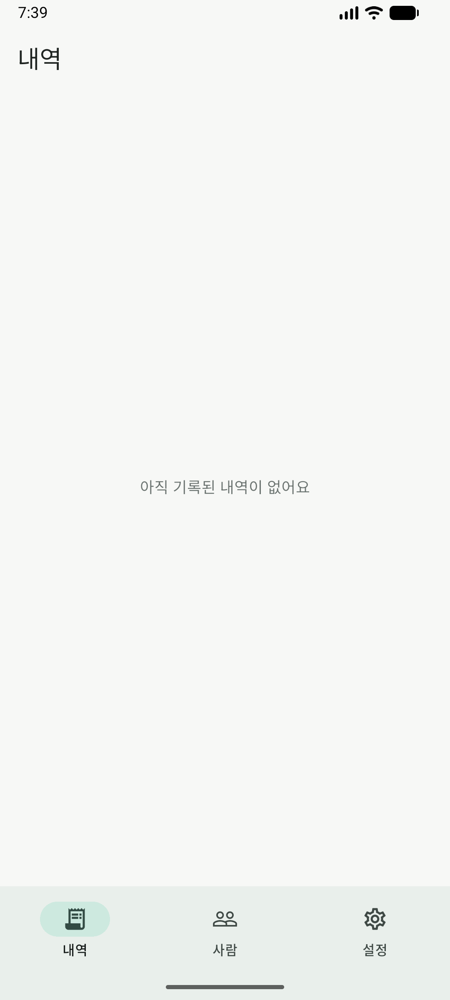
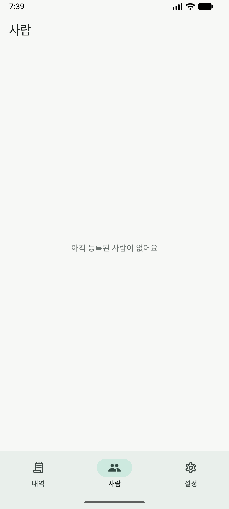
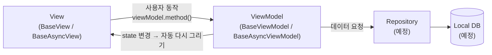

<div align="center">

# 💌 마음장부

**주고받은 마음을 잊지 않도록, 경조사 기록 앱**

축의금·부조금 등 경조사에서 주고받은 내역을 기록하고,<br/>
사람별로 정리해 "누구에게 얼마를 받았고, 얼마를 보냈는지" 한눈에 확인합니다.

<br/>


</div>

---

## 📱 스크린샷

<div align="center">

| 내역 | 사람 | 설정 |
|:---:|:---:|:---:|
|  |  |  |

</div>

> 현재는 앱 뼈대 단계입니다. 기능이 추가될 때마다 스크린샷을 갱신합니다.

---

## ✨ 주요 기능

| 상태 | 기능 | 설명 |
|:---:|---|---|
| ✅ | 하단 탭 내비게이션 | 내역 / 사람 / 설정 탭 전환, 탭별 상태 유지 |
| ✅ | 공통 로딩·오류 처리 | 데이터 로딩 중 표시, 실패 시 "다시 시도" 화면 자동 제공 |
| ⬜ | 경조사 내역 기록 | 날짜·종류(결혼·장례·돌 등)·금액·받음/보냄 기록 |
| ⬜ | 사람별 정리 | 사람마다 주고받은 합계와 히스토리 |
| ⬜ | 로컬 저장 | 기기 내부 DB 저장 (오프라인·무료) |
| ⬜ | 일정 알림 | 다가오는 경조사 알림 |

---

## 🛠 기술 스택

| 구분 | 사용 기술 |
|---|---|
| Framework | Flutter 3.50 (stable) · Dart 3.14 |
| 상태관리 | [flutter_riverpod](https://pub.dev/packages/flutter_riverpod) 3.5 (`Notifier` / `AsyncNotifier`) |
| 아키텍처 | MVVM + 공통 Base 클래스 |
| 버전 관리 | [FVM](https://fvm.app)으로 Flutter SDK 버전 고정 |
| 테스트 | flutter_test (위젯 테스트) |

**Riverpod을 선택한 이유**: pub.dev 기준 가장 활발히 유지보수되고(최근 30일 다운로드 약 447만), `Notifier`가 MVVM의 ViewModel 역할과 자연스럽게 맞으며, `autoDispose`로 화면 생명주기에 맞춘 자원 정리를 별도 바인딩 코드 없이 처리할 수 있습니다.

---

## 🏗 아키텍처

View는 **화면 그리기만**, ViewModel은 **상태와 로직만** 담당하도록 역할을 나눴습니다.



### 공통 Base 클래스

모든 화면은 아래 Base를 상속해 **같은 구조**로 작성합니다.

| 화면 종류 | ViewModel | View | 제공 기능 |
|---|---|---|---|
| 일반 화면 | `BaseViewModel<S>` | `BaseView<VM, S>` | 상태 구독·자동 리빌드 |
| 데이터 로딩 화면 | `BaseAsyncViewModel<S>` | `BaseAsyncView<VM, S>` | `load()` 자동 실행, 로딩/오류 UI, `reload()`, `runBusy()` |

```dart
// ViewModel: 상태(S)와 로직
class HistoryViewModel extends BaseAsyncViewModel<List<String>> {
  @override
  Future<List<String>> load() async => repository.fetchAll();
}

final historyViewModelProvider =
    AsyncNotifierProvider.autoDispose<HistoryViewModel, List<String>>(HistoryViewModel.new);

// View: 화면만
class HistoryView extends BaseAsyncView<HistoryViewModel, List<String>> {
  @override
  AsyncNotifierProvider<HistoryViewModel, List<String>> get provider => historyViewModelProvider;

  @override
  Widget buildView(BuildContext context, WidgetRef ref, List<String> data, HistoryViewModel viewModel) {
    return ListView(children: [for (final item in data) ListTile(title: Text(item))]);
  }
}
```

### 공통 디자인 시스템

색상은 `AppColors` 한 곳에서 관리하고, 화면 코드에서 색 값을 직접 쓰지 않습니다.

| 이름 | 용도 | 색 |
|---|---|---|
| `primary` | 대표 색 |  |
| `secondary` | 보조 강조 |  |
| `received` | 받은 금액 |  |
| `sent` | 보낸 금액 |  |
| `textPrimary` / `textSecondary` | 본문 / 보조 글자 |   |

---

## 📂 폴더 구조

```
lib/
├─ main.dart                    # 진입점 (ProviderScope)
├─ app.dart                     # MaterialApp · 테마 · 첫 화면
├─ core/
│  ├─ base/
│  │  ├─ base_view_model.dart   # BaseViewModel, BaseAsyncViewModel
│  │  └─ base_view.dart         # BaseView, BaseAsyncView
│  └─ theme/
│     ├─ app_colors.dart        # 공통 색상
│     └─ app_theme.dart         # ThemeData 구성
└─ ui/                          # 화면 = view + view_model 한 쌍
   ├─ main/                     # 하단 탭
   ├─ history/                  # 내역
   ├─ people/                   # 사람
   └─ settings/                 # 설정
```

---

## 🚀 실행 방법

```bash
# 1. 저장소 받기
git clone https://github.com/jjwwii/maeum_book.git
cd maeum_book

# 2. 프로젝트에 고정된 Flutter 버전 설치 (.fvmrc)
fvm install

# 3. 패키지 설치 및 실행
fvm flutter pub get
fvm flutter run

# 테스트
fvm flutter test
```

> FVM을 쓰지 않는다면 `fvm flutter` 대신 `flutter`로 실행해도 됩니다. (Flutter 3.50 이상)

---

## 🗺 로드맵

- [x] 프로젝트 세팅 (FVM, Git)
- [x] MVVM + Riverpod 뼈대, Base 클래스
- [x] 공통 색상·테마
- [ ] 데이터 모델 · 로컬 DB · Repository
- [ ] 내역 등록 / 수정 / 삭제
- [ ] 사람별 정리 및 합계
- [ ] 검색 · 필터 · 통계
- [ ] 경조사 일정 알림
- [ ] (선택) 클라우드 백업
