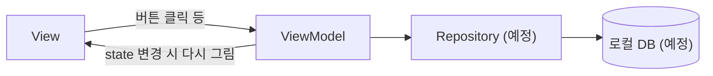

# 마음장부

경조사 때 주고받은 돈을 기록하는 앱입니다.

결혼식이나 장례식에 다녀오면 "그때 얼마 냈더라?", "저 사람한테는 얼마 받았었지?" 하고 헷갈릴 때가 많았습니다. 보통은 메모장이나 엑셀에 적어 두는데, 막상 필요할 때 찾기가 번거로워서 직접 만들어 보기로 했습니다.


## 화면

| 보내요 | 받아요 | 통계 | 설정 |
|:---:|:---:|:---:|:---:|
|  |  |  |  |

지금은 화면 구조와 디자인까지만 잡아 둔 상태라 데이터는 아직 비어 있습니다.

## 기능

만들려고 하는 기능은 아래와 같습니다. 체크된 건 구현이 끝난 것입니다.

- [x] 보내요 / 받아요 / 통계 / 설정 탭 구성
- [x] 공통 디자인(색상, 글꼴, 간격)과 공통 컴포넌트
- [ ] 보낸 내역, 받은 내역 기록 (날짜, 경조사 종류, 상대방, 금액, 메모)
- [ ] **엑셀 파일로 내보내기** — 기록한 데이터를 그대로 .xlsx로 추출
- [ ] 사람별로 주고받은 합계 보기
- [ ] 월별, 종류별 통계
- [ ] 다가오는 경조사 알림

엑셀 내보내기는 이 앱에서 제일 중요하게 생각하는 기능입니다. 부모님 세대처럼 엑셀로 정리해 두는 경우가 많아서, 앱에 쌓인 기록을 언제든 파일로 꺼내 볼 수 있어야 한다고 생각했습니다.

## 사용 기술

- Flutter 3.50 / Dart 3.14 (FVM으로 버전 고정)
- 상태관리: flutter_riverpod 3.5
- 글꼴: Pretendard(본문), 고운바탕(제목, 금액)

상태관리는 GetX, Provider, Bloc, Riverpod을 놓고 고민했습니다. GetX가 시작하기는 제일 쉬웠지만 최근 1년 동안 업데이트가 없었고, Provider는 만든 사람이 Riverpod 쪽을 권하고 있었습니다. Bloc은 이 정도 규모의 앱에는 코드가 너무 많아질 것 같았습니다. Riverpod은 지금도 꾸준히 업데이트되고 있고, `Notifier`가 MVVM의 ViewModel 역할과 잘 맞아서 최종적으로 골랐습니다.

## 구조

MVVM 패턴으로 나눴습니다. View는 화면을 그리는 일만 하고, 상태와 로직은 ViewModel이 맡습니다.



화면마다 같은 코드를 반복하지 않도록 기본 클래스를 먼저 만들어 두었습니다.

| 클래스 | 용도 |
|---|---|
| `BaseViewModel` / `BaseView` | 일반 화면 |
| `BaseAsyncViewModel` / `BaseAsyncView` | 데이터를 불러오는 화면. 로딩 표시와 오류 화면(다시 시도 버튼)이 자동으로 붙습니다 |

새 화면은 ViewModel에서 `load()`를, View에서 `buildView()`를 구현하면 됩니다.

```dart
class SentViewModel extends BaseAsyncViewModel<List<String>> {
  @override
  Future<List<String>> load() async => repository.fetchSent();
}

class SentView extends BaseAsyncView<SentViewModel, List<String>> {
  @override
  AsyncNotifierProvider<SentViewModel, List<String>> get provider => sentViewModelProvider;

  @override
  Widget buildView(BuildContext context, WidgetRef ref, List<String> data, SentViewModel viewModel) {
    return LedgerListLayout(title: '보내요', items: data, ...);
  }
}
```

### 코드 작성 규칙

- 공통으로 쓰는 UI는 `core/widgets`에 컴포넌트로 만들어 두고 가져다 씁니다. 보내요와 받아요 화면은 `LedgerListLayout` 하나를 같이 씁니다.
- 색, 글자 크기, 여백은 숫자를 직접 쓰지 않고 `AppColors`, `AppText`, `AppSpacing`에 정의된 값을 씁니다.
- 자주 쓰는 코드는 extension으로 만들었습니다. 예를 들어 `50000.won`은 `50,000원`, `55000.manWon`은 `5만 5,000원`, `date.toKoreanDate`는 `11월 24일 (화)`가 됩니다.
- 화면 파일은 `import 'package:maeum_book/core/core.dart';` 한 줄로 공통 코드를 모두 가져옵니다(barrel export).
- State 클래스는 `part` / `part of`로 ViewModel 파일과 나눠 둡니다.
- lint 규칙을 꽤 엄격하게 켜 두었습니다(`analysis_options.yaml`).

### 폴더 구조

```
lib/
├─ main.dart
├─ app.dart
├─ core/
│  ├─ core.dart          # 공통 코드를 한 번에 export
│  ├─ base/              # BaseView, BaseViewModel
│  ├─ theme/             # 색상, 글자 스타일, 간격, 테마
│  ├─ widgets/           # AppText, EmptyView, SummaryCard, LedgerListLayout
│  └─ extensions/        # int, String, DateTime, BuildContext, Widget 확장
└─ ui/
   ├─ main/              # 하단 탭
   ├─ sent/              # 보내요
   ├─ received/          # 받아요
   ├─ stats/             # 통계
   └─ settings/          # 설정
```

## 실행 방법

```bash
git clone https://github.com/jjwwii/maeum_book.git
cd maeum_book

fvm install
fvm flutter pub get
fvm flutter run
```

FVM이 없다면 `fvm flutter` 대신 `flutter`로 실행해도 됩니다. (Flutter 3.50 이상)

테스트는 `fvm flutter test`로 돌릴 수 있습니다.

## 디자인

손편지나 봉투 같은 느낌을 내고 싶어서 크림색 배경에 테라코타 색을 메인으로 잡았습니다. 보낸 금액은 붉은 계열, 받은 금액은 청록 계열로 구분했습니다. 제목과 금액에는 고운바탕을 써서 조금 더 따뜻하게 보이도록 했습니다.

## 라이선스

글꼴 라이선스는 `assets/fonts` 폴더에 함께 들어 있습니다(둘 다 SIL Open Font License).
