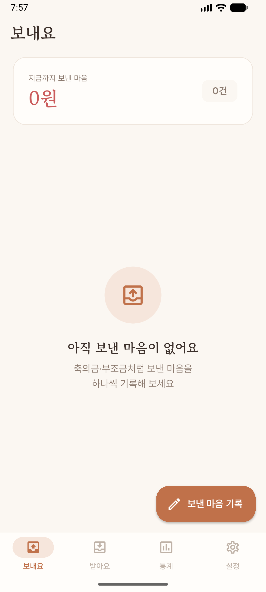
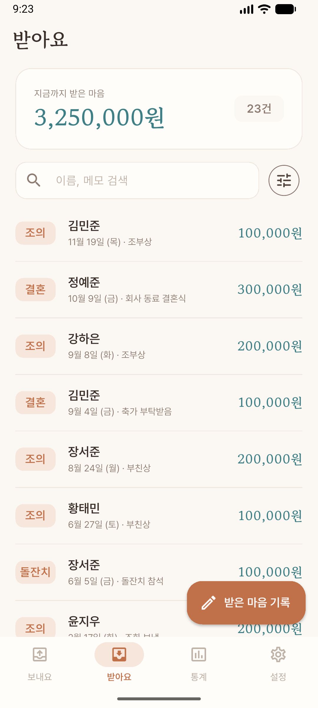
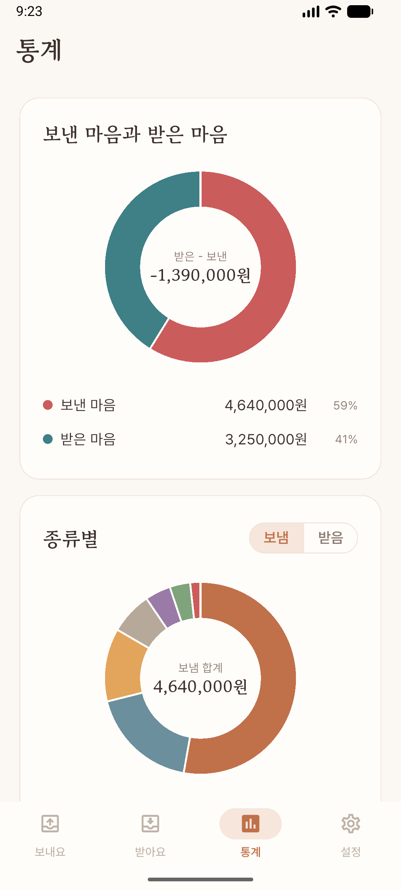
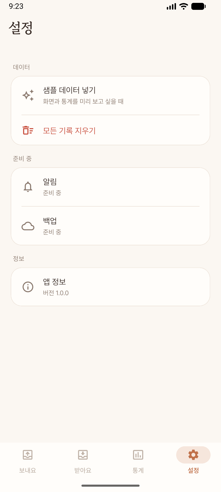
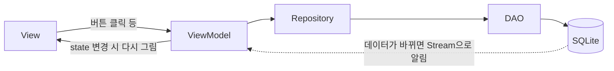

# 마음장부

경조사 때 주고받은 돈을 기록하는 앱입니다.

결혼식이나 장례식에 다녀오면 "그때 얼마 냈더라?", "저 사람한테는 얼마 받았었지?" 하고 헷갈릴 때가 많았습니다. 보통은 메모장이나 엑셀에 적어 두는데, 막상 필요할 때 찾기가 번거로워서 직접 만들어 보기로 했습니다.


## 화면

| 보내요 | 받아요 | 통계 | 설정 |
|:---:|:---:|:---:|:---:|
|  |  |  |  |

지금은 화면 구조와 디자인까지만 잡아 둔 상태라 데이터는 아직 비어 있습니다.

## 기능

만들려고 하는 기능은 아래와 같습니다. 체크된 건 구현이 끝난 것입니다.

- [x] 보내요 / 받아요 / 통계 / 설정 탭 구성
- [x] 공통 디자인(색상, 글꼴, 간격)과 공통 컴포넌트
- [x] 로컬 DB 저장 (Drift) — 보낸·받은 합계, 사람별 합계 쿼리까지
- [x] 보낸 마음, 받은 마음 입력 (필수: 구분·날짜·종류·상대방·금액 / 선택: 관계·메모) — 빠진 칸이 있으면 그 칸으로 스크롤하고 커서를 놓음 — 금액 빠른 버튼(+1만 ~ +100만), 모든 입력칸에 전체 지우기(ⓧ), 고르는 칩이 3줄을 넘으면 가로 스크롤
- [x] 기록 수정, 삭제 (왼쪽으로 밀어서 수정·삭제, 삭제 후 되돌리기)
- [x] **엑셀 파일로 내보내기** — 시트 4개(요약 · 보낸 · 받은 · 사람별), 합계는 엑셀 함수 + 계산값, 공유하기 · 내 휴대폰에 저장, 샘플로도 내보내기 (기획안: [docs/EXCEL_EXPORT_PLAN.md](docs/EXCEL_EXPORT_PLAN.md))
- [ ] 사람별로 주고받은 합계 화면
- [x] 통계: 보낸·받은 비율, 최근 12개월 월별 흐름, 종류별·관계별 비율(보냄/받음 전환), 많이 주고받은 사람 TOP 5
- [x] 검색(이름·메모), 필터(기간·경조사 종류)
- [x] 샘플 데이터로 둘러보기 (메모리에만 두고 앱을 끄면 사라짐 — 기기 DB · 서버에 쓰지 않음), 모든 기록 지우기 (설정)
- [x] 받아요를 행사 중심으로: 내 행사(결혼식·돌잔치 등)를 만들고, 행사마다 마음을 준 사람들을 기록
- [x] 경조사 종류 직접 추가·이름 변경·삭제 (설정)
- [ ] 다가오는 경조사 알림
- [x] 행사별 화환 · 꽃 사진: 찍기 · 앨범에서 여러 장, 보낸 분을 받은 기록에서 고르면 목록에 꽃 표시, 확대 보기 (비회원은 기기, 회원은 Supabase Storage + 기기 캐시, 기획안: [docs/EVENT_PHOTO_PLAN.md](docs/EVENT_PHOTO_PLAN.md))
- [x] 스플래시 화면
- [x] 화면 모드: 시스템(기기 설정 따라가기) · 라이트 · 다크 (설정, 기기에 저장)
- [x] 날짜 고르기: 아이폰은 돌림판, 안드로이드는 기본 달력
- [x] 설정 > 오픈소스 라이선스 (패키지는 자동, 글꼴 라이선스는 직접 등록)
- [x] 카카오 · Apple 로그인 (Supabase Auth), 자동 로그인 · 만료 안내, 로그아웃, 회원 탈퇴 — 설정 방법은 [docs/AUTH_SETUP.md](docs/AUTH_SETUP.md)
- [x] 로그인 없이 시작하기(비회원), 카카오 ↔ Apple 계정 연결
- [x] 회원 장부 서버 저장 (Supabase, 서버가 원본 · 기기는 계정별 사본), 첫 로그인 때 비로그인 기록 옮기기, 인터넷 끊김 안내
- [x] 설정 > 앱 정보: 설치된 버전 표시, 눌러서 최신 버전 확인 → 업데이트 안내 (지금은 TestFlight, 출시 후 App Store)

엑셀 내보내기는 이 앱에서 제일 중요하게 생각하는 기능입니다. 부모님 세대처럼 엑셀로 정리해 두는 경우가 많아서, 앱에 쌓인 기록을 언제든 파일로 꺼내 볼 수 있어야 한다고 생각했습니다. 그래서 DB 테이블도 처음부터 엑셀 열(날짜, 종류, 상대방, 금액, 보냄/받음, 관계, 메모)과 똑같이 잡았습니다.

엑셀 파일은 패키지를 쓰지 않고 직접 만듭니다. xlsx는 XML 파일 몇 개를 zip으로 묶은 것이라 필요한 부분만 작성했습니다([xlsx_writer.dart](lib/core/utils/xlsx_writer.dart)). 처음에는 `excel` 패키지를 쓰려고 했는데, 이 패키지는 함수만 넣고 계산 결과는 넣지 않습니다. 그러면 아이폰 미리보기나 카톡 미리보기처럼 직접 계산하지 않는 뷰어에서 합계가 빈칸으로 보입니다. 그래서 합계·소계·사람별 합계를 엑셀 함수(`SUM`, `SUMIF`, `SUMIFS`)로 넣되 앱이 미리 계산한 값도 함께 저장했습니다. 엑셀에서 기록을 고치면 다시 계산되고, 미리보기에서도 숫자가 보입니다. 덤으로 머리글 고정과 자동 필터도 넣을 수 있었습니다.

입력 화면에서는 경조사 종류를 일부러 미리 골라 두지 않았습니다. "결혼"이 기본으로 선택돼 있으면 장례인데도 그대로 저장하는 실수가 생기기 쉬울 것 같았습니다. 빠진 항목은 토스트 대신 해당 칸 아래에 바로 표시하고, 저장에 성공했을 때만 토스트를 띄웁니다. 탭을 누를 때마다 새로고침하지는 않습니다. 화면이 DB를 Stream으로 구독하고 있어서 데이터가 바뀌면 이미 자동으로 갱신되기 때문입니다.

받아요 탭은 처음엔 보내요와 똑같이 기록 목록이었는데, 받는 쪽은 "내 결혼식에 누가 얼마를 줬는지"처럼 행사 단위로 보는 게 자연스러워서 행사를 먼저 보여주고 그 안에 준 사람들을 넣는 구조로 바꿨습니다. 받은 기록의 날짜·종류는 행사를 따르게 해서 같은 걸 두 번 입력하지 않게 했습니다.

경조사 종류는 처음에 코드 안의 enum으로 고정했다가, 사람마다 필요한 종류(환갑, 졸업 등)가 달라서 DB 테이블로 옮겼습니다. 이미 쓰고 있는 종류를 지우면 그 기록들은 "기타"로 옮겨지고, "기타"는 지울 수 없게 막았습니다.

이 두 가지 때문에 DB 구조가 v2에서 v3으로 바뀌었는데, 이미 쓰던 데이터가 사라지면 안 되니까 마이그레이션을 직접 작성했습니다. 예전 받은 기록은 "같은 날짜 + 같은 종류"끼리 행사 하나로 자동으로 묶입니다. 예전 구조의 DB를 테스트에서 직접 만들어 놓고 업데이트 후 데이터가 제대로 옮겨지는지 확인하는 테스트도 넣었습니다.

검색과 필터는 DB를 다시 조회하지 않고 이미 받아 둔 목록에서 거릅니다. 개인 기록은 많아야 수백 건이라 그 편이 빠르고, 글자를 칠 때마다 화면이 깜빡이지 않습니다. 조건은 다른 탭에 갔다 와도 유지되고(보내요·받아요 따로), 앱을 다시 켜면 초기화됩니다. 대신 조건이 걸려 있으면 목록 위에 항상 칩으로 보여 줘서, 걸러진 목록이라는 걸 놓치지 않게 했습니다.

서버를 거치는 작업은 공통 로딩 막([app_loading.dart](lib/core/widgets/app_loading.dart))으로 감쌌습니다. 저장하기·로그인처럼 버튼을 누른 작업은 버튼 안에서 스피너가 돌고 화면은 그대로 두되 터치만 막습니다. 밀어서 삭제·로그아웃처럼 누를 버튼이 따로 없는 작업은 화면을 어둡게 덮고 흰 스피너와 문구를 보여 줍니다. 두 경우 모두 작업 중에는 뒤로 가기도 막고, 0.3초 안에 끝나는 작업은 깜빡이지 않게 화면을 덮지 않습니다. 통신 시간 제한은 Dart의 `timeout()`이 기다리기만 멈추고 요청은 그대로 보낸다는 점을 알게 돼서, 시간이 되면 요청 자체를 끊는 http 연결([timeout_http_client.dart](lib/data/remote/timeout_http_client.dart))을 Supabase에 끼웠습니다. 진짜로 연결이 끊기는지는 테스트에서 작은 서버를 띄워 확인했습니다.

회원 장부는 서버가 원본이라 앱을 켜거나 돌아올 때 서버 장부로 기기 사본을 통째로 바꿉니다. 그런데 앨범에서 사진을 고르고 돌아오는 순간 이 "받아 오기"와 사진 저장이 겹쳐서, 방금 넣은 사진이 받기 전 장부로 덮이는 버그가 테스터에게서 나왔습니다. 그래서 저장할 때마다 숫자를 하나 올리고, 받아 오는 사이 숫자가 바뀌었으면 덮어쓰지 않고 다시 받게 했습니다. 이 숫자는 저장 트랜잭션 **안에서** 올려야 틈이 없다는 것도 테스트로 재현하면서 알게 됐습니다. 동명이인은 앱이 사람을 구분할 방법이 이름뿐이라, 통계와 엑셀은 이름 + 관계로 묶고 화환 사진은 이름이 아니라 받은 기록 번호로 연결했습니다.

## 사용 기술

- Flutter 3.50 / Dart 3.14 (FVM으로 버전 고정)
- 상태관리: flutter_riverpod 3.5
- 로컬 DB: drift 2.35 (SQLite)
- 그래프: fl_chart(도넛·막대 차트 컴포넌트로 감쌈), 밀어서 삭제: flutter_slidable
- 화면 이동: go_router 18 (하단 탭은 StatefulShellRoute)
- 글꼴: Pretendard(본문), 고운바탕(제목, 금액)
- 배포: Codemagic(iOS → TestFlight), GitHub Actions(PR 검사, Android APK 릴리스 — 준비 중)

상태관리는 GetX, Provider, Bloc, Riverpod을 놓고 고민했습니다. GetX가 시작하기는 제일 쉬웠지만 최근 1년 동안 업데이트가 없었고, Provider는 만든 사람이 Riverpod 쪽을 권하고 있었습니다. Bloc은 이 정도 규모의 앱에는 코드가 너무 많아질 것 같았습니다. Riverpod은 지금도 꾸준히 업데이트되고 있고, `Notifier`가 MVVM의 ViewModel 역할과 잘 맞아서 최종적으로 골랐습니다.

DB는 개인용 앱이라 서버 없이 휴대폰 안에 저장하기로 했습니다. 처음엔 Hive를 생각했는데 원래 패키지는 2022년 이후로 업데이트가 멈춰 있었습니다. 그리고 이 앱은 "사람별 합계", "월별 합계"처럼 묶어서 더하는 일이 많아서 키-값 저장소보다 SQL이 낫다고 판단했고, 타입 안전하게 SQL을 쓸 수 있는 Drift를 골랐습니다. Drift는 테이블이 바뀌면 Stream으로 새 결과를 보내주기 때문에, 기록을 저장하면 목록과 합계가 따로 새로고침하지 않아도 바로 바뀝니다.

화면 이동은 go_router를 썼습니다. 탭 화면 위에 입력·상세 화면이 쌓이는 구조라 경로로 화면을 관리하는 편이 깔끔했고, Flutter 팀이 직접 관리하는 패키지라 오래 쓰기에도 안심이 됐습니다.

## 구조

MVVM 패턴으로 나눴습니다. View는 화면을 그리는 일만 하고, 상태와 로직은 ViewModel이 맡습니다. ViewModel은 DB를 직접 모르고 Repository만 통해서 데이터를 가져옵니다.



화면마다 같은 코드를 반복하지 않도록 기본 클래스를 먼저 만들어 두었습니다.

| 클래스 | 용도 |
|---|---|
| `BaseViewModel` / `BaseView` | 일반 화면 |
| `BaseAsyncViewModel` / `BaseAsyncView` | 데이터를 불러오는 화면. 로딩 표시와 오류 화면(다시 시도 버튼)이 자동으로 붙습니다 |

`BaseAsyncViewModel`은 한 번만 읽으면 되는 데이터는 `load()`, DB처럼 계속 바뀌는 데이터는 `watch()`를 구현하면 됩니다. `watch()`를 쓰면 구독과 해제까지 기본 클래스가 처리합니다.

보내요와 받아요는 데이터 방향만 다르고 나머지는 같아서 ViewModel과 View를 하나씩만 만들고 방향만 바꿔 끼웁니다(Riverpod family).

```dart
class LedgerListViewModel extends BaseAsyncViewModel<LedgerListState> {
  LedgerListViewModel(this.direction);
  final RecordDirection direction;

  @override
  Stream<LedgerListState> watch() =>
      ref.watch(ledgerRepositoryProvider).watchEntries(direction).map((entries) => LedgerListState(entries: entries));
}

// 탭에서는 이렇게 씁니다
const LedgerListView(direction: RecordDirection.sent)
const LedgerListView(direction: RecordDirection.received)
```

### 코드 작성 규칙

- 공통으로 쓰는 UI는 `core/widgets`에 컴포넌트로 만들어 두고 가져다 씁니다. 목록 화면 틀은 `LedgerListLayout`, 기록 한 줄은 `LedgerEntryTile`입니다.
- 색, 글자 크기, 여백은 숫자를 직접 쓰지 않고 `AppColors`, `AppText`, `AppSpacing`에 정의된 값을 씁니다.
- 자주 쓰는 코드는 extension으로 만들었습니다. 예를 들어 `50000.won`은 `50,000원`, `55000.manWon`은 `5만 5,000원`, `date.toKoreanDate`는 `11월 24일 (화)`가 됩니다.
- 고정값(앱 이름, DB 이름, 입력 제한 등)은 `AppDefine`, 화면 경로는 `AppRoutes`, 콜백 타입(`IntCallback`, `ErrorCallback` 등)은 `typedefs.dart`에 모아 두었습니다.
- 화면 파일은 `core/core.dart`, `data/data.dart` 두 줄로 필요한 코드를 모두 가져옵니다(barrel export).
- State 클래스는 `part` / `part of`로 ViewModel 파일과 나눠 둡니다.
- lint 규칙을 꽤 엄격하게 켜 두었습니다(`analysis_options.yaml`).

### 폴더 구조

```
lib/
├─ main.dart
├─ app.dart
├─ core/
│  ├─ core.dart          # 공통 코드를 한 번에 export
│  ├─ base/              # BaseView, BaseViewModel
│  ├─ define/            # 고정값, 화면 경로, 콜백 타입
│  ├─ theme/             # 색상, 글자 스타일, 간격, 테마
│  ├─ widgets/           # AppText, EmptyView, SummaryCard, LedgerListLayout, AppToast, 폼 컴포넌트
│  └─ extensions/        # int, String, DateTime, BuildContext, Widget 확장
├─ router/              # go_router 설정 (화면 이동 지도)
├─ data/
│  ├─ data.dart
│  ├─ models/            # 보냄/받음, 경조사 종류, 합계 모델
│  ├─ database/          # Drift DB, 테이블(기록·행사·경조사 종류), DAO, 마이그레이션
│  ├─ repositories/      # ViewModel이 쓰는 저장소
│  └─ providers.dart     # DB, Repository provider
└─ ui/
   ├─ main/              # 하단 탭
   ├─ ledger/            # 보내요 (기록 목록, 검색·필터)
   ├─ event/             # 받아요 (행사 목록, 행사 상세, 행사 만들기)
   ├─ event_type/        # 경조사 종류 관리
   ├─ entry/             # 기록 입력
   ├─ stats/             # 통계
   └─ settings/          # 설정
```

## 자동화 테스트 (Appium)

나중에 Appium으로 UI 자동화 테스트를 돌릴 수 있도록, 누르거나 확인해야 하는 화면 요소에는 고정된 이름을 붙여 두었습니다. 이름은 `lib/core/define/test_ids.dart`에 모여 있습니다.

Flutter의 `Semantics.identifier`를 쓰기 때문에 Android에서는 `resource-id`, iOS에서는 `accessibilityIdentifier`로 그대로 보입니다. 화면 문구가 바뀌어도 테스트가 깨지지 않고, 사용자의 화면 낭독(TalkBack)에는 영향이 없습니다.

```
Android (UiAutomator2):  driver.findElement(By.id("tab_stats"))
iOS (XCUITest):          driver.findElement(AppiumBy.accessibilityId("tab_stats"))
```

| 이름 | 요소 |
|---|---|
| `tab_sent`, `tab_received`, `tab_stats`, `tab_settings` | 하단 탭 |
| `ledger_add_sent`, `ledger_summary_sent` | 기록 버튼, 합계 카드 |
| `entry_tile_{id}`, `entry_edit_{id}`, `entry_delete_{id}` | 기록 한 줄, 밀어서 나오는 버튼 |
| `form_event_type_wedding`, `form_person_name`, `form_amount`, `form_amount_add_50000`, `form_save` 등 | 입력 화면 |
| `toast` | 토스트 |

같은 이름을 위젯 테스트에서도 `find.bySemanticsIdentifier(...)`로 쓰고 있어서, 이름이 빠지면 위젯 테스트에서 먼저 걸립니다. 테스트 전에 데이터를 비우려면 `adb shell pm clear com.maeumbook.maeum_book`을 쓰면 됩니다.

## 실행 방법

```bash
git clone https://github.com/cwi112/maeum_book.git
cd maeum_book

fvm install
fvm flutter pub get
fvm flutter run
```

FVM이 없다면 `fvm flutter` 대신 `flutter`로 실행해도 됩니다. (Flutter 3.50 이상)

APK로 설치해 보려면 `fvm flutter build apk --release`로 만들면 `build/app/outputs/flutter-apk/app-release.apk`가 생깁니다. 설정 탭의 "샘플 데이터로 둘러보기"를 누르면 여러 종류의 예시 기록이 메모리에만 만들어져서 통계와 검색을 바로 확인해 볼 수 있습니다. 내 기록과 섞이지 않고, [끝내기]를 누르거나 앱을 끄면 사라집니다.

테스트는 `fvm flutter test`로 돌릴 수 있습니다. DB 테스트는 메모리 DB를 써서 실제 데이터를 건드리지 않습니다.

DB 테이블이나 쿼리(`lib/data/database`)를 고쳤다면 Drift 코드를 다시 생성해야 합니다.

```bash
fvm dart run build_runner build
```

## 배포

배포는 명령 하나로 TestFlight까지, 한 줄 더로 App Store 심사 제출 · Google Play 업로드까지 나갑니다. 자세한 흐름은 [docs/DEPLOY.md](docs/DEPLOY.md), 스토어 첫 출시 준비는 [docs/STORE_RELEASE.md](docs/STORE_RELEASE.md), 서버 용량 검토는 [docs/SERVER_CAPACITY.md](docs/SERVER_CAPACITY.md)에 정리했습니다.

```powershell
.\scripts\release.ps1 1.0.1
```

- 스크립트가 `pubspec.yaml`의 버전과 빌드 번호를 올리고 `v1.0.1` 태그를 붙이면, 두 곳에서 동시에 배포가 시작됩니다.
  - **Android** (준비 중): GitHub Actions가 서명된 APK를 만들어 GitHub Releases에 올립니다. 폰에서 링크를 눌러 바로 설치할 수 있습니다. (카카오톡은 APK 전송을 막아서 이 방식을 택했습니다.)
  - **iOS**: Windows에서 개발하고 있어 iOS를 직접 빌드할 수 없기 때문에, [Codemagic](https://codemagic.io)의 클라우드 Mac에서 빌드해 TestFlight에 올립니다. 배포 인증서와 프로비저닝 프로파일은 Codemagic에 한 번 등록해 두고, 빌드할 때 번들 ID로 찾아 서명합니다.
- 업데이트 소식은 [docs/RELEASE_NOTES.md](docs/RELEASE_NOTES.md), TestFlight 문구는 
elease_notes.json(Codemagic이 자동 등록), 스토어 스크린샷은 store_assets/(실제 화면을 규격별로 자동 생성)에 있습니다.
- 빌드 번호를 스크립트가 한 곳(pubspec)에서만 올리기 때문에, 두 플랫폼의 버전이 항상 같고 스토어에서 번호가 겹치는 일이 없습니다.
- 같은 스크립트가 저장소의 `app_version.json`(최신 버전, 업데이트 주소)도 올립니다. 앱의 설정 > 앱 정보를 누르면 이 파일과 설치된 버전을 비교해, 새 버전이 있으면 업데이트할 곳으로 보냅니다. 별도 서버 없이 GitHub의 파일 하나로 처리했고, App Store에 출시하면 앱을 다시 배포하지 않고 이 파일의 `iosUrl`만 바꾸면 됩니다.

## 디자인

손편지나 봉투 같은 느낌을 내고 싶어서 크림색 배경에 테라코타 색을 메인으로 잡았습니다. 보낸 금액은 붉은 계열, 받은 금액은 청록 계열로 구분했습니다. 제목과 금액에는 고운바탕을 써서 조금 더 따뜻하게 보이도록 했습니다.

목록 화면은 스크롤에 따라 조금씩 반응하게 했습니다. 목록을 내리면 위쪽(합계 카드·검색창) 아래에 옅은 그림자가 생기고, 기록 버튼은 작은 동그라미로 접혔다가 목록 끝에 닿으면 아래로 숨습니다. 처음엔 버튼이 마지막 줄을 가리지 않게 목록 아래에 큰 빈 공간을 뒀는데 보기 좋지 않아서, 버튼이 끝에서 비켜 주는 방식으로 바꿨습니다. 이 동작은 `AppListScaffold` 컴포넌트 하나에 모아 두고 보내요·받아요·행사 화면이 같이 씁니다.

다크 모드도 새까만 검정 대신 따뜻한 고동색 바탕에, 강조색을 한 톤 밝게 올려 같은 분위기를 유지했습니다. 이미 화면마다 `AppColors.primary` 같은 이름으로 색을 쓰고 있어서, 그 이름은 그대로 두고 값만 라이트 · 다크 팔레트([app_colors.dart](lib/core/theme/app_colors.dart))에서 나오게 바꿨습니다. 색이 바뀌는 걸 위젯이 알 수 없으니, 앱 맨 위의 `AppPaletteSync`가 팔레트를 바꾼 뒤 아래 화면을 전부 다시 그리게 했습니다. 화면 상태와 입력값은 그대로 남습니다.

앱 아이콘도 같은 느낌으로 테라코타 배경에 하트로 봉한 편지 봉투를 그렸습니다. 원본은 `assets/icon`에 있고, `fvm dart run flutter_launcher_icons`로 Android(적응형 아이콘 포함), iOS, 웹 아이콘을 한 번에 만듭니다.

## 라이선스

글꼴 라이선스는 `assets/fonts` 폴더에 함께 들어 있습니다(둘 다 SIL Open Font License).
